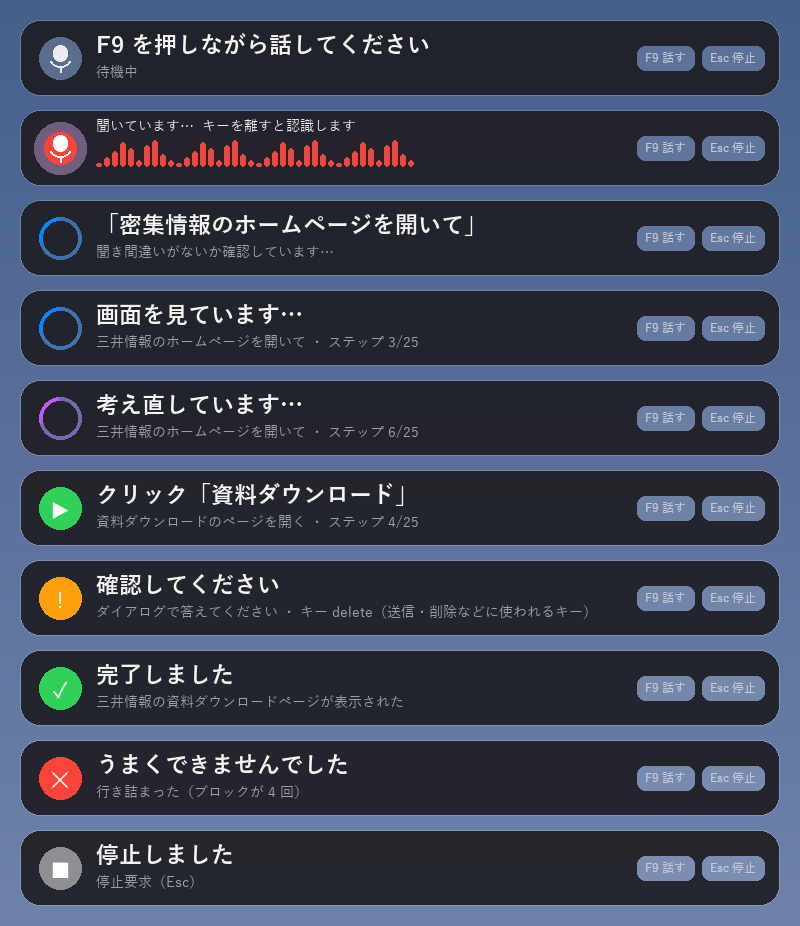

# 音声で操作する Windows コンピュータ操作エージェント（展示デモ）

日本語で話しかけると、AI が画面を見ながらマウスとキーボードを操作して、指示を実行します。

```
F9 を押しながら話す → 文字に起こす（faster-whisper）
  → スクリーンショットをモデルに送る → モデルが次の1手を JSON で返す
  → 安全ルールで確かめる → マウス・キーボードで実行 → 画面が落ち着くのを待つ → 繰り返し
  → 結果を読み上げる（Windows の音声合成）
```

- 画面を見て判断するモデル: vLLM の OpenAI 互換 API（既定は `GLM-5.3-Flash-EXL3`）
- macOS 用アプリ [roangws/nemotron-3.5-super-computer-use-app](https://github.com/roangws/nemotron-3.5-super-computer-use-app)（MIT ライセンス）を参考に、Windows 11 向けに作り直したものです。

> **注意:** `--live`（実際に操作するモード）で動かすと、マウスとキーボードが勝手に動きます。
> 展示 PC 以外では、まず dry-run（操作せずに表示だけ）で試してください。

---

## 目次

1. [動作環境](#動作環境)
2. [セットアップ](#セットアップ)
3. [使い方](#使い方)
4. [安全のしくみ](#安全のしくみ)
5. [設定](#設定)
6. [ログとレポート](#ログとレポート)
7. [音声認識をよくするには](#音声認識をよくするには)
8. [うまくいかないとき](#うまくいかないとき)
9. [既知の制約](#既知の制約)
10. [開発者向け](#開発者向け)

---

## 動作環境

| 項目 | 内容 |
|---|---|
| OS | Windows 11（モニター1台。1920×1080・拡大率100%で確認） |
| Python | 3.12 |
| パッケージ管理 | [uv](https://docs.astral.sh/uv/)（`python -m pip install --user uv` で入る） |
| モデルのサーバー | vLLM（OpenAI 互換 API）。画像を入力できるモデル |
| マイク | 押して話す方式。ヘッドセットか単一指向性マイクを推奨 |
| 読み上げ | Windows の日本語音声（Microsoft Haruka）。Windows 11 日本語版には標準で入っています |
| CPU | 4 コアで、音声認識（small）が1回約2秒 |

音声認識のモデル（約0.5GB）は初回のセットアップでダウンロードします。その後は、展示会場でインターネットに出られなくても動きます（モデルのサーバーへの接続は必要です）。

## セットアップ

1. uv を入れます（入っていなければ）。

   ```bat
   python -m pip install --user uv
   ```

2. このフォルダの **`setup.bat`** をダブルクリックします。次のことを順に行います。
   - 必要なパッケージを入れる（`uv sync`）
   - `.env.example` をコピーして `.env` を作る（すでにあれば何もしない）
   - 音声認識のモデルを `models/` にダウンロードする
   - 環境を確認する（下のような結果が出ます。すべて `[OK]` なら準備完了です）

   ```
   [OK]   SetProcessDpiAwareness(2)
   [OK]   import 全モジュール import 成功
   [OK]   画面サイズ mss=[(1920, 1080)] pyautogui=1920x1080 DPI=96（100%=96）
   [OK]   日本語音声 (SAPI5) 日本語=['Microsoft Haruka Desktop - Japanese'] …
   [OK]   マイク入力デバイス […]
   [OK]   音声認識モデル small（models/ にあり）
   [OK]   モデルAPI /models ['GLM-5.3-Flash-EXL3']
   ```

3. モデルのサーバーの URL が既定（`http://172.25.5.48:8000/v1`）と違うときは、`.env` の `VA_BASE_URL` を書き換えます（[設定](#設定)）。

環境の確認だけをやり直すときは **`check_env.bat`** を使います。

## 使い方

### 起動用のバッチファイル

| ファイル | 内容 |
|---|---|
| `start_voice.bat` | **音声モード（本番）**。F9 を押しながら話すと、実際に操作します |
| `start_voice_dryrun.bat` | 音声モードのリハーサル。何をするかを表示するだけで、**マウスもキーボードも動かしません** |
| `start_text.bat` | 文字で指示するモード。`タスク>` に指示を入力すると、実際に操作します。空行で終了します |
| `check_env.bat` | 環境の確認（操作はしません） |
| `setup.bat` | 初回のセットアップ |

### デスクトップのアイコン

デスクトップに「音声操作エージェント」のアイコン（青地に白いマイク）を作れます。ダブルクリックすると `start_voice.bat` が起動します。

```bat
python -m uv run python scripts/create_shortcut.py           & rem 音声モード（本番）のアイコン
python -m uv run python scripts/create_shortcut.py --dryrun  & rem リハーサル用のアイコンも作る
```

### 音声モードの操作

1. `start_voice.bat` を起動して、「準備ができました」と出るまで待ちます（数秒）。
2. **F9 を押したまま**話し、話し終わったら離します。
   - 例：「メモ帳を開いてこんにちはと入力して」「電卓で36かける12を計算して」「Edge で三井情報のホームページを開いて」
3. 認識した文が表示され、エージェントが操作を始めます。操作の理由を読み上げます。
4. 終わると「完了しました」などと読み上げ、次の指示を待ちます。

| したいこと | 操作 |
|---|---|
| 操作を止める | **Esc**（すぐ止まります。モデルのサーバーでの生成も止まります） |
| 非常停止 | マウスを**画面の隅**へ動かす |
| 終了する | コンソールで **Ctrl+C** |

### 画面上の状態表示

画面の上のほうに、Spotlight のようなバーで今の状態を表示します。端末を見なくても、何をしているかが分かります。



実際には、このうち1本が画面の上のほうに表示されます。見本の画像は `scripts/render_overlay_states.py` で作り直せます（バーの見た目を変えたときに実行します）。

| 表示 | 状態 |
|---|---|
| グレーのマイク「F9 を押しながら話してください」 | 待機中 |
| 赤いマイクと音の大きさのバー「聞いています…」 | F9 を押している（録音中） |
| 青い回転「認識しています…」「聞き間違いがないか確認しています…」「画面を見ています…」 | 処理中 |
| 紫の回転「考え直しています…」 | 行き詰まって、思考ありで考え直している |
| 緑の ▶「クリック「資料ダウンロード」」など | 操作中（下の行に理由とステップ数） |
| オレンジの !「確認してください」 | 確認ダイアログで答える必要がある |
| 緑の ✓「完了しました」／赤の ✕「うまくできませんでした」／グレーの ■「停止しました」 | 結果（しばらくすると待機中に戻る） |

- バーはクリックを素通りし、フォーカスも取りません。エージェントの操作の邪魔をしません。
- スクリーンショットには写りません（モデルには見えません）。
- 位置や表示の有無は、config.yaml の `ui.overlay` で変えられます。

### 聞き間違いの補正

認識した文は、実行する前にモデルで聞き間違いを直します（1〜2秒）。手がかりは、手がかりの単語一覧（`voice.stt.vocabulary`）、直前の指示、操作対象のアプリの画面にあるボタン・リンクの名前です。

- 例：「密集情報のホームページを開いて」→「三井情報のホームページを開いて」、「エッジのオドロボタン」→「戻るボタン」、「資料セーキはダウンロード」→「資料ダウンロード」
- 直したときは「〜を実行します」と読み上げ、端末に「補正: 「…」→「…」」と出します。
- 何の指示か分からないとき（「お持ち賛同の天気」など）は、**実行せずに「もう一度お願いします」と聞き直します**。
- 補正の前後の文はレポートに残ります。設定は `voice.correction` です。

### 確認ダイアログ

送信・削除・購入などの操作の前に、画面の中央に「次の操作を実行してよいですか？」と出ます。**操作の担当者が答えてください。**

- 宛先のアプリと操作が指示どおりなら「はい、実行する」を押します。
- 迷ったら「いいえ（中止）」を押すか、Esc を押します。30秒何もしないと、自動で「いいえ」になります。どの場合も、何も実行せずに止まります。

### コマンドで起動する場合

```bat
cd /d C:\Users\admin\voice-agent
python -m uv run voice-agent --voice --live                       & rem 音声モード
python -m uv run voice-agent --voice --live --stt-model large-v3-turbo
python -m uv run voice-agent --live "電卓で12かける34を計算して"     & rem 1回だけ実行
python -m uv run voice-agent --dry-run "メモ帳を開いて"              & rem 操作せず表示だけ
```

| オプション | 内容 |
|---|---|
| `--voice` | 音声モード |
| `--live` / `--dry-run` | 実際に操作する／表示だけ（既定は config.yaml の `agent.dry_run`） |
| `--stt-model` | 音声認識のモデル（`small`、`large-v3-turbo` など） |
| `--no-tts` | 読み上げをしない |
| `--max-steps` | 最大ステップ数（25 より大きくはできません） |
| `--delay` | 開始までの待ち秒数（文字で指示するとき、その間に対象アプリを前面に出せます） |
| `--think-normal` / `--think-stuck` | 思考モード（`off` / `low` / `on`）。通常時と行き詰まったとき |

### 操作できるアプリ

アプリを開く操作（`open_app`）で開けるのは、config.yaml の `apps` に書いたアプリだけです。既定はメモ帳・電卓・Edge・Chrome・ペイントです。開いたウィンドウは最大化します。

## 安全のしくみ

モデルへの指示（プロンプト）ではなく、**プログラムのコードで強制**しています。

| ルール | 内容 |
|---|---|
| 人間の確認 | 送信・削除・購入・提出・投稿などの語（入力する文字、操作の理由、クリック先のボタン名）、危ないキー（Delete、Ctrl+Enter、Alt+F4 など）、モデルが「危ない」と判断した操作は、実行前に確認ダイアログを出します |
| パスワードの拒否 | パスワード欄への入力や、パスワードを入力しようとする操作は止めます |
| 宛先の照合 | 文字入力・キー操作の前に、前面のアプリがモデルの言う宛先と同じかを確かめます。違えば実行しません |
| 実行直前の確認 | モデルが考えている間に前面のウィンドウが変わったら（人が別のウィンドウを触ったときなど）、実行せずに画面を見直します |
| 保護するアプリ | 端末・Claude・エクスプローラーなど、エージェント自身の環境への入力は拒否します |
| 拒否するキー | Windows キーの組み合わせ、Ctrl+Alt+Delete など |
| アプリの許可リスト | `apps` にないアプリは開きません |
| 回数の上限 | 1つの指示につき最大25ステップで止まります |
| 行き詰まりの打ち切り | 効かなかった操作の繰り返しを止め、それが4回たまったら打ち切ります。思考は3,000トークン・90秒までです |
| 即時停止 | Esc（人が押したときだけ）、マウスを画面の隅へ |

## 設定

### config.yaml

各項目の説明は、ファイルの中にコメントで書いてあります。変更したら起動し直してください。

| セクション | よく変える項目 |
|---|---|
| `model` | `base_url`・`name`（モデルのサーバー）、`thinking_normal`・`thinking_stuck`（思考モード）、`max_tokens_thinking` |
| `agent` | `dry_run`、`max_steps`、`maximize_on_open`（開いたウィンドウの最大化）、`give_up_after_blocks` |
| `apps` | 開いてよいアプリ（呼び名・起動コマンド・プロセス名） |
| `safety` | 確認が必要な語・キー、拒否するキー、保護するアプリ、確認ダイアログの待ち時間 |
| `voice` | `ptt_key`（押して話すキー）、`input_device`（マイク）、`stt.model`、`stt.vocabulary`（認識の手がかり）、`correction`（聞き間違いの補正）、`tts.rate`（読み上げの速さ）、`tts.speak`（読み上げる内容） |
| `ui` | `overlay`（画面上の状態表示。`enabled`、`position`: top / bottom、`y`） |

### .env（秘密情報・環境ごとの値）

`.env.example` を `.env` という名前でコピーして使います。`.env` は git に入りません。書いた項目だけが config.yaml より優先されます。

| 変数 | 内容 |
|---|---|
| `VA_BASE_URL` | モデルの API の URL |
| `VA_MODEL` | モデル名 |
| `VA_API_KEY` | API キー（サーバーで設定している場合だけ。画面やログには出しません） |

## ログとレポート

1回の指示ごとに `runs/<日時>-<指示>/` に記録が残ります。**`report.html` をブラウザで開く**と、各ステップでモデルが見た画面、クリック位置、理由、結果を順に見られます。音声で指示した場合は、録音も再生できます。

| ファイル | 内容 |
|---|---|
| `report.html` | 実行レポート（ダークモード対応） |
| `step-NN-sent.jpg` / `step-NN-marked.jpg` | モデルに送った画面と、操作の印を付けた画面 |
| `model/step-NN.json` | モデルへの指示・返答・思考・トークン数 |
| `ledger.jsonl` / `summary.json` | ステップごとの記録と、結果のまとめ |
| `audio.wav` | 音声で指示したときの録音 |
| `runs/index.jsonl` | すべての実行の一覧 |

「完了（要確認）」と表示された実行は、モデルが「完了」と言ったものの、画面が変わらなかった操作があったものです。結果を確かめてください。

`runs/` にはスクリーンショットが残るので、展示の後は必要に応じて消してください。

## 音声認識をよくするには

- **マイクが最も大事です。** リモートデスクトップ経由のマイクは、音が小さく圧縮もされるので、認識が悪くなります。展示 PC に直接つないだヘッドセットか単一指向性マイクを使い、Windows の入力レベルを上げてください。
- **固有名詞は手がかりに書きます。** `voice.stt.vocabulary` の上のほうに、展示で使う会社名・製品名・サイト名を足します。たとえば「三井情報」は、足す前は「密集情報」と認識されていました。
  - 単語だけを書きます。「〜を開いて」のような文は書かないでください（聞き取れなかったときに、その文がそのまま指示として実行されることがあります）。
  - 上限（150 トークン）を超えた単語は使われません。使われなかった単語は起動時に表示されます。
- **F9 を押してから話し始め、話し終わってから離します。** 押す直前の0.5秒も録音しているので、少し早く話し始めても切れません。
- **モデルを比べます。** 録音した声でモデルを比べられます。

  ```bat
  python -m uv run python scripts/stt_compare.py --record 3                    & rem F9 を押しながら3回話す
  python -m uv run python scripts/stt_compare.py --wav runs\…\audio.wav          & rem 過去の録音で比べる
  ```

  4 コアの CPU では、small が約2秒、large-v3-turbo が約6.5秒でした。large-v3-turbo は英語交じりに少し強い一方、短い日本語ではかえって外すこともありました。vCPU を増やすと、大きいモデルが速くなります。大きいモデルを使うときは、先に `scripts/download_models.py large-v3-turbo` でダウンロードしてください。

## うまくいかないとき

| 症状 | 原因と対処 |
|---|---|
| `uv` が見つからない | `python -m pip install --user uv`。バッチファイルは `uv` がなければ `python -m uv` を使います |
| 「声が聞こえませんでした」「聞き取れませんでした」 | マイクの選択と入力レベルを確認します。リモートデスクトップでは、接続の設定で「リモート オーディオ → 録音する」を有効にします。`voice.input_device` でマイクを指定することもできます |
| 「モデル呼び出しエラー」 | モデルのサーバーに届いていません。`check_env.bat` の「モデルAPI」を確認し、`.env` の `VA_BASE_URL` を見直します |
| 入力が効かないのに「完了」と言う | モデルの「完了」は自己判断です。「完了（要確認）」と出たら、画面を確かめてください |
| 同じ操作を繰り返す | 繰り返しは自動で止め、続けば打ち切ります。止まらなければ Esc を押します |
| クリックの後に別のウィンドウが前に出る | Edge で起きることがあります。クリックしたアプリを自動で前面に戻します。レポートに「前面に戻した」と記録されます |
| リンクをクリックしても開かない | Edge で起きます（Chrome では起きませんでした）。Edge のリンクは、マウスでクリックせずに UI Automation で直接押します（`agent.invoke_links_in`）。他のアプリでも、クリックで画面が変わらなかったリンク・ボタンは直接押します。レポートに「直接押した」と記録されます |
| リンクを押したのに「完了」と言うが、ページが変わっていない | ブラウザでは、リンクを押した後にページの題名が変わらなければ「効果なし」とみなし、「完了（要確認）」と警告します。スライドショーなど勝手に動く画像があると、画面の変化だけでは判定できないためです |
| 「実行せず: 考えている間に前面が…に変わった」 | エージェントが考えている間に、別のウィンドウ（端末など）がクリックされました。**動いている間は PC に触らない**でください |
| メモ帳に F・E などの小さな札が出たまま | Alt キーのキーヒントです。メモ帳の本文をクリックするか、Esc を押して消します |
| 読み上げが途中で切れる | `voice.tts.engine` が `sapi` か確認します（`pyttsx3` だと、この環境では2回目以降が切れました） |
| 考え中のまま長く止まる | 思考は最大90秒で打ち切ります。待てないときは Esc を押します |

## 既知の制約

- モデルの「完了」「失敗」は、モデル自身の判断です。結果は保証されません。
- 対応しているのはモニター1台だけです（主モニターのみを見て操作します）。
- 音声認識の誤り（例:「戻る」→「オドロ」）があると、存在しないボタンを探し続けることがあります。行き詰まったら打ち切ります。
- Edge で、クリックした後に後ろのウィンドウが前面に出ることがあります。原因は調査中で、クリック中の前面ウィンドウの変化をレポートに記録しています。
- 1回の操作に3〜4秒かかります（モデルの応答時間）。

## 開発者向け

### 構成

```
config.yaml            設定
.env.example           .env のひな形（秘密情報はここではなく .env へ）
*.bat                  起動用のバッチファイル
src/voice_agent/
  main.py              起動口（テキスト・音声モード、確認ダイアログとの接続）
  agent.py             操作ループ（撮影 → モデル → 検証 → 安全ルール → 実行 → 待つ）
  prompts.py           モデルへの指示文
  model_client.py      vLLM（OpenAI 互換 API）の呼び出し（ストリーミング、停止・時間切れで接続を切る）
  actions.py           操作の JSON の正規化・検証、アプリの許可リスト
  safety.py            安全ルール
  executor.py          マウス・キーボードの実行（dry-run あり）
  screen.py            スクリーンショット、画面の変化の判定、落ち着き待ち
  winapi.py / uia.py   前面ウィンドウ・前面化・最大化 / UI Automation（クリック先の要素名・パスワード欄）
  confirm_ui.py        確認ダイアログ
  overlay.py           画面上の状態表示（Spotlight 風のバー。クリック素通り・スクリーンショットに写らない）
  correct.py           聞き間違いの補正
  stopkey.py           Esc での停止
  logbook.py           ログと report.html
  voice.py             音声モードのループ
  ptt.py / recorder.py 押して話すキー / マイク録音
  stt.py / tts.py      音声認識（faster-whisper）/ 読み上げ（SAPI5・pyttsx3、差し替え可能）
scripts/
  check_env.py         環境の確認
  download_models.py   音声認識モデルのダウンロード
  stt_compare.py       音声認識モデルの比較
  render_overlay_states.py  README 用の状態表示の見本画像（docs/overlay_states.png）を作る
  coord_test.py        モデルの座標の精度テスト
  action_demo.py       1ステップの dry-run デモ
tests/                 単体テスト（実際のマウス・キーボード・アプリは使いません）
```

### テスト

```bat
python -m uv run pytest -q
```

モデルのサーバー・マウス・キーボード・マイクは使いません（偽物に置き換えています）。`models/` に small があるときだけ、合成音声での認識テストも行います。

### モデルの JSON

モデルは、1ステップに1つ、次の形の JSON を返します。座標は、送った画像（幅 1512px）のピクセル座標です。

```json
{"action": "click", "x": 640, "y": 360, "text": "", "dy": 0, "target_app": "", "risky": false, "reason": "OKボタンを押す"}
```

`action` は `click` / `double_click` / `type` / `key` / `scroll` / `open_app` / `done` / `fail` のいずれかです。

### ライセンス

参考にした [roangws/nemotron-3.5-super-computer-use-app](https://github.com/roangws/nemotron-3.5-super-computer-use-app) は MIT ライセンスです。このリポジトリのライセンスは未定です。
